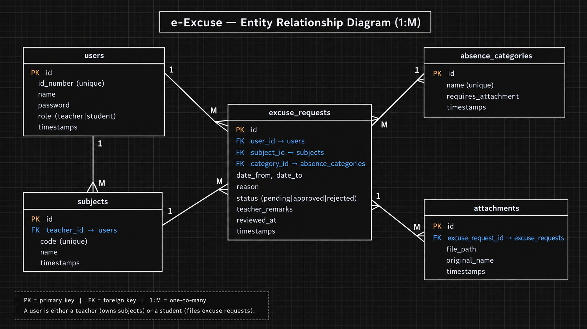

# e-Excuse — Student Absence Management System

**Developer:** Hope John Bagaipo, BSIT 3 — Section 1  
**Client/theme:** Mater Dei College; a responsive school portal for filing and reviewing student absence excuses.

e-Excuse replaces paper and chat based excuse letters with a single system. Students submit a request with dates, a reason, and supporting documents. Teachers review requests for their subjects, record remarks, and approve or reject them. Both roles can track request status and see dashboard summaries.

## Features

- Sanctum token registration, login, logout, and current-user lookup
- Teacher and student roles, enforced in the API and reflected in the React routes
- Excuse request, subject, and category management
- Per-subject requests, attachment uploads, and teacher review remarks
- Search and filters for request lists; keyword search for subjects
- API pagination with React page controls
- Database-backed dashboard summaries and charts
- React and Laravel validation, field-level errors, loading states, toasts, and delete confirmations
- Pending requests can be approved or rejected by the teacher assigned to the subject

## Tech stack

- **Frontend:** React 18, Vite, React Router, Axios, Context API, Tailwind CSS, Recharts
- **Backend:** Laravel 12, PHP 8.2+, Laravel Sanctum
- **Database:** MySQL
- **Tools:** Composer, npm, Git, Postman

## Repository layout

```text
backend/       Laravel API, migrations, models, factories, seeders, feature tests
frontend/      React SPA
docs/          ERD, API collection, presentation, and screenshots
```

## Setup

### Requirements

PHP 8.2+ with `pdo_mysql`, `mbstring`, `openssl`, and `fileinfo`; Composer; Node.js/npm; and MySQL or MariaDB. XAMPP or Laragon can provide the database.

### 1. Configure and run Laravel

```powershell
cd backend
composer install
Copy-Item .env.example .env
php artisan key:generate
```

Create an empty database named `e_excuse`, then set `DB_DATABASE`, `DB_USERNAME`, and `DB_PASSWORD` in `backend/.env`. Set `FRONTEND_URL=http://localhost:5173` for the Vite development server.

```powershell
php artisan migrate --seed
php artisan storage:link
php artisan serve
```

The API is available at `http://localhost:8000/api`. Run the feature tests with `php artisan test` (requires `pdo_sqlite`).

### 2. Configure and run React

Open a second terminal:

```powershell
cd frontend
npm install
Copy-Item .env.example .env
npm run dev
```

The SPA is available at `http://localhost:5173`. `frontend/.env.example` sets `VITE_API_URL=http://localhost:8000/api`.

## Seeded demo accounts

The seeder creates four teacher accounts, ten student accounts, six categories, four subjects, and 30 sample requests. Teacher password is `password`; student passwords match their ID numbers.

| Role | ID number | Password | Name |
|---|---|---|---|
| Teacher | `T-1001` | `password` | Jhon lyod Catalan |
| Teacher | `T-1002` | `password` | Ricardo JR Rosco |
| Student | `15749` | `15749` | Hope John Bagaipo |
| Student | `15750` | `15750` | Mike Palapar |

Other seeded students use IDs `15751`–`15757` and `25000`; each password matches their ID.

## API documentation

Base URL: `http://localhost:8000/api`. Protected routes use `Authorization: Bearer <token>`.

The [Postman collection](docs/e-Excuse.postman_collection.json) includes the API requests and stores the login token automatically.

| Method | Endpoint | Access | Purpose |
|---|---|---|---|
| `POST` | `/register` | Public | Register a student |
| `POST` | `/login` | Public | Log in and receive a token |
| `POST` | `/logout` | Authenticated | Revoke current token |
| `GET` | `/user` | Authenticated | Get current user |
| `GET` | `/dashboard` | Authenticated | Get role-scoped summary figures |
| `GET` | `/options` | Authenticated | Get subject and category options |
| `GET` | `/requests` | Authenticated | List requests with search, filters, and pagination |
| `POST` | `/requests` | Student | Create requests, with optional attachments |
| `GET`, `PUT`, `DELETE` | `/requests/{id}` | Policy controlled | Read, update, or delete a request |
| `PATCH` | `/requests/{id}/status` | Teacher for the subject | Approve or reject with remarks |
| `GET` | `/subjects`, `/subjects/{id}` | Authenticated | List or view subjects |
| `POST`, `PUT`, `DELETE` | `/subjects[/{id}]` | Teacher | Manage own subjects |
| `GET` | `/categories`, `/categories/{id}` | Authenticated | List or view categories |
| `POST`, `PUT`, `DELETE` | `/categories[/{id}]` | Teacher | Manage categories |

Typical responses include `200`, `201`, `204`, `401`, `403`, `404`, and `422`. A `409` response prevents deleting subjects or categories already in use.

## Database design



Tables include `users`, `subjects`, `absence_categories`, `excuse_requests`, `attachments`, and Sanctum's `personal_access_tokens`.

## Presentation and screenshots

- [Presentation slides (PDF)](docs/e-Excuse_Presentation.pdf)
- [Application screenshots](docs/screenshots/)

## Security and configuration

- Real `.env` files, dependencies, generated builds, and local uploads are excluded by `.gitignore`. Commit `.env.example` files only.
- Passwords are hashed; Sanctum tokens are sent as bearer tokens; login is throttled.
- Middleware and policies enforce role, ownership, and teacher-subject access in Laravel. React route guards are a UI layer, not the security boundary.
- Attachments are limited to PDF/JPG/PNG, 4 MB per file, and three files per request.
